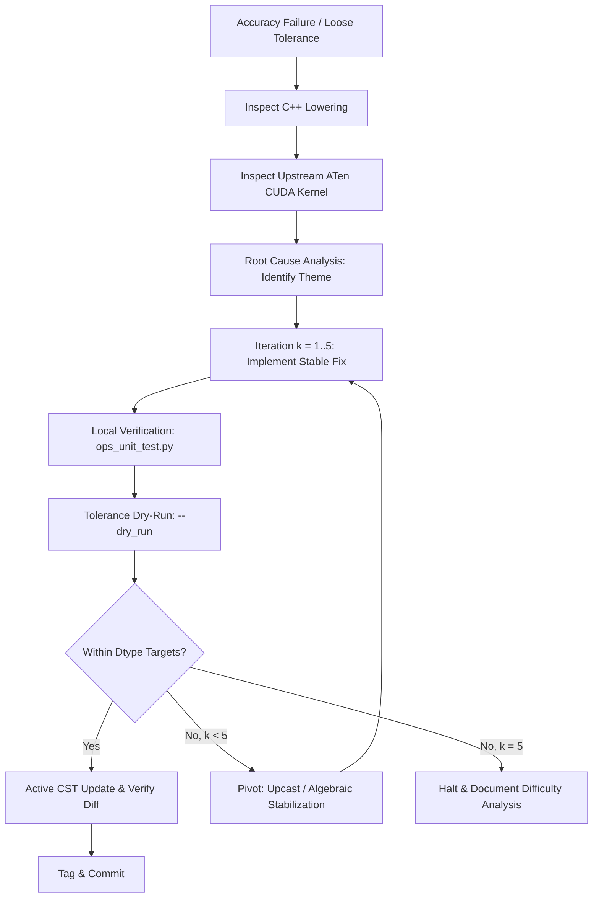

# TorchTPU Fixing Op Lowering Tolerances

Diagnose and resolve numerical accuracy gaps in TorchTPU operators: upstream
CUDA parity comparison, root cause analysis, target tolerances per dtype,
anti-patterns, and an iterative tolerance-update workflow loop capped at 5
iterations.

## Core Philosophy: Fix Lowerings, Do Not Hide Precision Gaps

Accuracy is a foundational pillar of TorchTPU. When an operator fails accuracy
tests in `ops_test.py`, **always** investigate and fix the underlying lowering —
mathematically sound formulations, proper intermediate accumulation — rather
than loosening tolerance bounds.

Tolerance overrides in `ops_test.py` (`ACCURACY_OVERRIDES_VS_GPU` and
`ACCURACY_OVERRIDES_VS_GPU_COMPILED`) exist solely to capture fundamental,
unavoidable hardware differences (e.g. TPU vs GPU FMA rounding, 7-bit bfloat16
mantissa). They must **never** mask a flawed or sub-optimal lowering.



## 1. Target Op Identification & Codebase Reconnaissance

Given a target operator (e.g. `frac`, `linspace`, `cdist`, `matmul`,
`group_norm`, `_softmax_backward_data`), gather full context:

1.  **C++ lowering**: the StableHLO lowering under `csrc/ops/` (e.g.
    `csrc/ops/{op}/{op}_aten_kernels.cc` or `csrc/ops/{op}.cc`), plus builder
    utilities in `csrc/ops/op_builder_utils.h` and
    `csrc/ops/precision_context.h`.
2.  **Existing overrides**: `tests/ops_test.py`, entries in
    `ACCURACY_OVERRIDES_VS_GPU` and `ACCURACY_OVERRIDES_VS_GPU_COMPILED`. Check
    both `atol` and `rtol` against the §4 thresholds. Any override on an integer
    or boolean dtype is a bug.
3.  **Unit and parity tests**: `ops_unit_test.py` (edge cases, dtype coverage,
    shape variations, non-contiguous layouts) and `ops_test.py` (`OpInfo`
    data-driven accuracy suites). See
    [tt-write-tests](../tt-write-tests/SKILL.md).

## 2. Upstream CUDA / GPU Parity & Reference Kernel Inspection

Before modifying any C++ lowering, you MUST inspect the upstream PyTorch native
CUDA kernel in `aten/src/ATen/native/cuda/` in the `pytorch/pytorch` repository
(e.g. `RangeFactories.cu`, `Binary*OpsKernels.cu`, `Normalization.cu`,
`SoftMax.cu`); CPU references live in the sibling `native/cpu/`. Identify where
numerical divergence originates:

1.  **Accumulator and intermediate math types**: `at::acc_type<scalar_t, true>`
    is the accumulator type (e.g. `float` for `half`/`bfloat16`) and
    `at::opmath_type<scalar_t>` the calculation type for transcendentals. Check
    whether CUDA computes in `float` (F32) even for integer types — CUDA
    `linspace` uses `float step = (end - start) / (steps - 1)` for integral
    inputs.
2.  **Rounding, truncation, and casting semantics**: C++
    `static_cast<scalar_t>(val)` **truncates towards zero**
    ($\operatorname{trunc}(x)$). In StableHLO, `ConvertElementType` from float
    to integer on TPU without explicit truncation produces rounding
    discrepancies near transition boundaries (e.g. $0.99999994$ vs
    $1.00000004$). To match ATen float-to-integer semantics, apply explicit
    sign-aware truncation (`Abs -> Floor -> Mul(Sign)`) before
    `ConvertElementType`.
3.  **Algorithmic formulation and stability tricks**: bidirectional splitting at
    the midpoint to minimize error accumulation (`ind < steps / 2 ? start + step
    *   ind : end - step * (steps - ind - 1)`); `log-sum-exp`max subtraction,
        centered variance ($x - \mu$), or compensated summation; and whether
        CUDA computes`a * b + c` as a single fused multiply-add.
4.  **Host-side vs kernel-side argument conversion**: whether PyTorch's ATen
    dispatcher casts scalar arguments on the host or preserves their full scalar
    precision into the kernel.

## 3. Empirical Root Cause Analysis: Common Lowering Themes

Six empirical themes account for the critically loose tolerances observed in
TorchTPU.

### Theme 1: Mathematical Definition Disparity

`frac` / `_foreach_frac` (`atol=1.3`): `BuildFracShlo` in `csrc/ops/unary.cc`
computed `Subtract(input, Floor(input))`, but ATen defines `frac(x) = x -
trunc(x)` (truncation towards zero). For $x = -1.5$ PyTorch returns $-0.5$
whereas TorchTPU computed $\mathbf{+0.5}$ — 100% relative error with an inverted
sign.

**Remedy**: align exactly with the PyTorch specification, using
$\operatorname{trunc}(x) = \operatorname{sign}(x) \cdot \lfloor |x| \rfloor$.

### Theme 2: Host-Side / Kernel-Entry Premature Scalar Downcasting

*   `linspace`: `AtenLinspaceOut` promotes scalars via
    `start_promoted.GetTensor(output_dtype)` on the host, so `start` and `end`
    lose precision before interpolation begins for `bfloat16`, `float16`, and
    `int32` outputs.
*   `pow`: `AtenPowTensorScalarOut` calls
    `promoted_exponent.GetTensor(self.scalar_type())`, casting float exponents
    to the tensor's integer type and turning `pow(int_tensor, 0.5)` into
    `pow(int_tensor, 0) == 1`.
*   `_foreach_addcdiv` / `addcmul`: `out_dtypes` is inferred strictly from
    `self`, truncating a small scalar learning rate (e.g. `1e-4`) to `bfloat16`
    on the host and introducing substantial step rounding.

**Remedy**: preserve scalar precision in host helpers. Convert scalars to `F32`
or `F64` inside the MLIR graph, not during argument extraction.

### Theme 3: Continuous Float Emulation for Discrete Integer Operations

*   `linspace` on integers (`atol=1.3`): computes continuous `F64` division and
    interpolation, then casts to integer at the end. ATen CPU/CUDA use discrete
    integer arithmetic and exact integer rounding rules, causing $\pm 1$
    truncation discrepancies across hardware.
*   `_foreach_pow` on integers: lowering integer powers via continuous
    `stablehlo::Pow` ($e^{y \ln x}$) introduces transcendental approximation and
    overflow errors for exact integer arithmetic.

**Remedy**: implement discrete integer formulas for integer inputs, e.g.
$((\text{end} - \text{start}) \times i) / (\text{steps} - 1)$, or repeated
binary squaring for integer powers.

### Theme 4: `Precision::DEFAULT` & Missing FP32 Accumulation in Contractions

Affects `matmul`, `mm`, `bmm`, `conv2d`, `conv_transpose2d`.
`g_global_precision` in `csrc/ops/precision_context.cc` defaults to
`Precision::DEFAULT` (`"medium"`), which on TPU Matrix Units (MXUs) uses
single-pass reduced-precision (14-bit mantissa) arithmetic rather than full IEEE
float32. Separately, `BuildMmShlo`, `BuildBmmShlo`, and `BuildConvolution` emit
StableHLO directly on `bfloat16` operands without configuring `float32`
accumulation.

**Remedy**: where high numeric fidelity is required, configure
`PrecisionConfigAttr` as `Precision::HIGH` or `HIGHEST`, and evaluate `bfloat16`
matrix contractions and convolutions with `float32` accumulation.

### Theme 5: Unpromoted Reductions & Overflow in Derived Statistics

*   `group_norm` backward: spatial and channel reductions run in native
    `bfloat16`/`float16`. Evaluating $rstd^3 = (\sigma^2 + \epsilon)^{-3/2}$ in
    `float16` immediately overflows ($> 65504 \to \text{Inf}/\text{NaN}$) for
    small variances.
*   `convolution_backward` bias: `BuildConvolutionBackwardBias` sums over $B
    \times H \times W$ directly in `output_dtype` (`bfloat16`), losing
    accumulated gradient precision.
*   `cdist` ($p = 2.0$): Euclidean distance squares differences directly in
    input precision, causing immediate overflow in `float16`/`bfloat16`.

**Remedy**: **always** upcast operands to `float32` before reductions
(`ReduceOp`, `ReduceWindowOp`). Compute normalization statistics (mean,
variance, $rstd$, $rstd^3$) in `float32`, and downcast to the target dtype only
after scaling the output.

### Theme 6: Catastrophic Cancellation in Low-Precision Backward Passes

`_softmax_backward_data` and `_log_softmax_backward_data` evaluate $\partial L /
\partial x_i = g_i - \exp(y_i) \sum_j g_j$ directly in `bfloat16`. When $g_i
\approx \exp(y_i) \sum g_j$, subtracting two nearly identical 7-bit mantissa
numbers cancels out all significant digits.

**Remedy**: upcast gradient inputs and forward activations to `float32` before
the sum reduction and the difference; downcast to `bfloat16` only after
completing the subtraction.

## 4. Reasonable Target Tolerances by Dtype

Evaluate every suggestion against these bounds before committing an override to
`ops_test.py`. Never exceed them without mathematical proof that the operation
is fundamentally ill-conditioned.

*   **`float32`**: `rtol <= 1e-4`, `atol <= 1e-3` (23-bit mantissa, $\epsilon
    \approx 1.19\text{e-}7$). Above $1\text{e-}3$ indicates a lowering bug.
*   **`bfloat16`**: `rtol <= 1e-2`, `atol <= 1e-2` (7-bit mantissa, $\epsilon
    \approx 7.8\text{e-}3$). Never accept above $5\text{e-}2$.
*   **`float16`**: `rtol <= 5e-3`, `atol <= 1e-3` (10-bit mantissa, $\epsilon
    \approx 9.77\text{e-}4$). Narrow dynamic range ($65504$ max).
*   **`int8` / `int16` / `int32` / `int64` / `bool`**: `0.0` (exact). Tolerance
    overrides on integer and boolean dtypes are forbidden.
*   **`float8_*` / `float4_*`**: `rtol <= 1e-1`, `atol <= 5e-2`. Bounds depend
    on the format (E4M3 vs E5M2).

> [!IMPORTANT] **The Red Flag Rule**: If a proposed fix or dry-run makes
> tolerances **worse** than the prior baseline (e.g. increasing `atol` from
> $1.3$ to $2.0$, or introducing new looser errors), or suggests tolerances such
> as `rtol: 0.1` or `atol: 0.2` for `float32`/`bfloat16`, **do NOT write this to
> `ops_test.py`**. Treat it as an immediate rejection of the current lowering.

## 5. Anti-Patterns to Strictly Avoid

*   **NO raw XLA/HLO bypassing StableHLO**: construct MLIR only via
    `mlir::stablehlo::*` or `mlir::chlo::*` and `op_builder_utils`.
*   **NO Pallas / Triton / handwritten hardware kernels** to fix tolerances. Ops
    must lower to StableHLO/CHLO graphs the compiler can optimize.
*   **NO casual tolerance bumping** in `ops_test.py` as a shortcut to make tests
    pass without first investigating lowering precision.
*   **NO host-side scalar truncation**: do not call
    `promoted_scalar.GetTensor(low_precision_dtype)` on the host when building
    math kernels. Pass scalars in full precision to MLIR.
*   **NO direct reduction in 16-bit floats**: never build `ReduceOp` or
    `ReduceWindowOp` accumulating in `bfloat16`/`float16` across large
    dimensions. Upcast to `F32` first.
*   **NO ATen tensor captures in builder lambdas** and **NO dispatcher calls
    inside `TT_KERNEL`**: see [tt-implement-ops](../tt-implement-ops/SKILL.md)
    and [tt-fix-composite-ops](../tt-fix-composite-ops/SKILL.md) for the native
    helpers to use instead.

## 6. Iterative Feedback Loop (Max 5 Iterations)

Execute the fix loop under a **hard maximum of 5 iterations**. If the targets
are not met by then, **halt further code changes** and perform the §7 Difficulty
Analysis.

1.  **Diagnose and fix.** Inspect the existing C++ lowering in `csrc/ops/` and
    compare it against the upstream CUDA kernel in `ATen/native/cuda/`.
    Formulate a *specific* hypothesis (e.g. "intermediate powers evaluated in
    `bfloat16` rather than `float32`"), then implement it using
    `ConvertElementType` upcasting, high-precision accumulation, and stable math
    functions.
2.  **Verify locally.** Build the op target, then run `ops_unit_test` and
    `ops_test` filtered to the op. See
    [tt-write-tests](../tt-write-tests/SKILL.md) for the commands.
3.  **Measure.** Run the tolerance workflow in dry-run mode and inspect the
    suggestions, per [tt-update-tolerances](../tt-update-tolerances/SKILL.md)
    steps 1-2.
4.  **Decision gate.** Evaluate the suggestions on two independent checks:
    **target bounds** (within the §4 thresholds for every dtype) and **no
    regression** (equal to or tighter than the previous baseline).
    *   **Both pass**: exit the loop and land the fix.
    *   **Either fails and $k < 5$**: revert the ineffective edit, increment
        $k$, pivot to a different algebraic formulation (log-domain arithmetic,
        compensated summation, higher intermediate precision), and return to
        step 1.
    *   **Either fails and $k = 5$**: **halt code modifications** and produce
        the §7 Difficulty Analysis.

**Landing the fix.** Follow
[tt-update-tolerances](../tt-update-tolerances/SKILL.md) steps 3-5 for the
active run, the diff verification, and the pull request description. One of its
rules is restated because this loop makes it easy to violate: the pull request
description MUST include the `Tolerances comparison:` table and test output
evidence from the tolerance-update workflow.

## 7. Difficulty Analysis Framework (When 5 Iterations Fail)

If the operator cannot reach the target bounds in 5 iterations, stop making
ad-hoc lowering changes and write a Difficulty Analysis Report explaining the
fundamental constraint, across four dimensions:

1.  **Hardware FMA rounding divergence.** MXUs use 14-bit-mantissa intermediates
    in single-pass `Precision::DEFAULT` (Theme 4); GPUs use IEEE 754 float32 FMA
    with 23 bits. For large contractions (`matmul`, `bmm`, `conv2d`) or long
    reductions, rounding differences accumulate with the reduction length $N$,
    giving an unavoidable $\sim 1\text{e-}3 \dots 5\text{e-}3$ float32 error.
2.  **Reciprocal and transcendental approximation.** TPU division and $\sqrt{x}$
    go through reciprocal approximation plus Newton-Raphson refinement
    (`ReciprocalOp`, `RsqrtOp`); GPUs execute direct hardware division. When
    step sizes such as $(b - a) / (N - 1)$ or normalizers are multiplied across
    large index ranges, the initial roundoff is amplified near boundaries.
3.  **Discrete transition boundary drift.** Casting continuous float arithmetic
    to integers can yield $m - \epsilon$ on TPU and $m + \epsilon$ on GPU for a
    value mathematically equal to $m$; truncation then gives $m - 1$ vs $m$ — a
    $\pm 1$ mismatch producing $\text{atol} = 1.0$ (or $\text{rtol} > 0.4$) on
    integer ranges despite infinitesimal float error.
4.  **Upstream PyTorch / CUDA quirks.** Upstream kernels carry known
    idiosyncrasies: non-deterministic reduction order, legacy empirical step
    formulations, unpromoted intermediates in old code. Check the PyTorch issue
    tracker and comments in `common_methods_invocations.py` (e.g. `# Extra case
    to replicate off-by-one issue on CUDA`). If CUDA exhibits an upstream
    artifact, link the issue and explain why replicating the quirk in StableHLO
    is mathematically undesirable.

## 8. Concrete Lowering Patterns

Every pattern shares one shape: resolve a high-precision `comp_dtype` with
`InferComputationDtype(out_type)`, upcast the operands, compute, and cast back
to `out_type` only at the very end.

```cpp
// Pattern A: intermediate precision upcasting and stable downcasting.
TT_ASSIGN_OR_RETURN(mlir::ElementType comp_dtype,
                    InferComputationDtype(out_type));
TT_ASSIGN_OR_RETURN(mlir::MlirOp input_comp, CastIfNeeded(input, comp_dtype));

// Complex arithmetic (Erf, Log1p, Expm1, Pow) stays in high precision.
mlir::MlirOp intermediate = mlir::chlo::ErfOp(input_comp);
TT_ASSIGN_OR_RETURN(mlir::MlirOp scaled, BuildMulShlo(intermediate, ...));

return CastIfNeeded(scaled, out_type);  // Convert back only at the end.
```

```cpp
// Pattern B: accumulate reductions in F32 to prevent truncation and overflow.
mlir::MlirBuilder& builder = input.getBuilder();
auto comp_mlir_type = mlir::getElementType(builder.getContext(), comp_dtype);
TT_ASSIGN_OR_RETURN(mlir::MlirOp input_comp, CastIfNeeded(input, comp_dtype));

mlir::MlirOp init_val = MakeScalarConstant(builder, 0.0, comp_dtype);
auto reduce_fn = [comp_mlir_type](mlir::RegionBuilder& rb) {
  mlir::stablehlo::buildReduceBody<mlir::stablehlo::AddOp>(
      comp_mlir_type, rb.getRegion(), rb.getOpBuilder());
};
mlir::MlirOp sum_comp =
    BuildReductionShlo(input_comp, dims, comp_mlir_type, init_val, reduce_fn,
                       ReductionMode::kNone);
return CastIfNeeded(sum_comp, out_type);
```

```cpp
// Pattern C: match ATen trunc(x) = sign(x) * floor(|x|), not naive floor(x).
mlir::MlirOp abs_val = mlir::stablehlo::Abs(input_comp);
mlir::MlirOp floor_abs = mlir::stablehlo::Floor(abs_val);
mlir::MlirOp sign_val = mlir::stablehlo::Sign(input_comp);
mlir::MlirOp trunc_val = mlir::stablehlo::Mul(sign_val, floor_abs);

mlir::MlirOp frac_comp = mlir::stablehlo::Subtract(input_comp, trunc_val);
return CastIfNeeded(frac_comp, out_type);
```

```cpp
// Pattern D: softmax backward in F32 to avoid catastrophic cancellation.
TT_ASSIGN_OR_RETURN(mlir::MlirOp grad_comp,
                    CastIfNeeded(grad_output, comp_dtype));
TT_ASSIGN_OR_RETURN(mlir::MlirOp out_comp, CastIfNeeded(output, comp_dtype));

// Sum reduction across the target dim in comp_dtype.
TT_ASSIGN_OR_RETURN(mlir::MlirOp sum_grad_comp,
                    BuildReduceSumShlo(grad_comp, {dim}));
mlir::MlirOp exp_out_comp = mlir::stablehlo::Exp(out_comp);
mlir::MlirOp scaled_grad_comp =
    mlir::stablehlo::Mul(exp_out_comp, sum_grad_comp);

mlir::MlirOp result_comp =
    mlir::stablehlo::Subtract(grad_comp, scaled_grad_comp);
return CastIfNeeded(result_comp, out_type);
```
