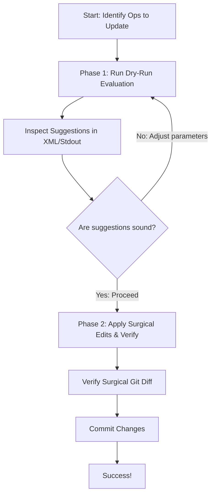

# Fortified TorchTPU Tolerance Update Workflow

This skill provides comprehensive instructions for running the fortified
TorchTPU tolerance update workflow, explaining command ordering, parameter
tuning, and operational guardrails.

## Workflow Overview

The fortified tolerance update workflow operates under a **safety-first**
two-phase architecture to ensure source files are never altered without prior
explicit verification:

1.  **Phase 1: Dry-Run (Verification & Analysis)**: Runs underlying accuracy
    tests with `--test_arg=--ignore_accuracy_overrides`, analyzes failure
    distributions, and logs mathematically computed tolerance recommendations in
    standard formats without modifying disk files.
2.  **Phase 2: Active Run (Surgical Modification & Validation)**: Applies
    recommendations directly to `tests/ops_test.py` in strict alphabetical
    order, formats the modified code with `nox -s format`, and re-executes final
    verification assertions without `--ignore_accuracy_overrides`.



## Crucial Best Practices & Operational Guardrails

-   **Run Operators Sequentially (One by One)**: Always restrict evaluations to
    a single operator per execution using `--test_filter=TestOps.test_<op_name>`
    (e.g., execute separate sequential runs for `addmm`, `var`, `exp`). Running
    operators individually keeps execution fast (finishing in 1-2 minutes per
    op) and avoids hitting test timeout limits. Each update cleanly merges
    changes into `tests/ops_test.py` without disturbing prior edits.
-   **No Cache & Timeout Specification**: Always specify
    `--nocache_test_results` and `--test_timeout=3600` (or
    `--test_arg=--timeout=3600`) when executing underlying evaluations. This
    guarantees fresh evaluations without reusing stale test failure caching and
    prevents timeouts.
-   **Workspace Cleanup (Remove XML Files)**: After completing a run for a
    single operator, **removing cached JUnit XML files** (such as
    `bazel-testlogs/tests/ops_test*/test.xml`) is strongly recommended to clean
    up the workspace. This prevents stale XML reports and suggestions from prior
    operator sweeps from lingering and confusing subsequent evaluations.
-   **Safety Gates**: Follow these safety checks to protect repository integrity
    during workflow execution:
    -   *Fail-Fast on Non-Accuracy Errors/Timeouts*: If an underlying
        `bazel test` run crashes, times out, or fails with non-accuracy errors
        during evaluation, abort immediately and fix the underlying issue before
        updating tolerances.
    -   *Zero-Test Abort Protection*: Verify that at least one test case was
        executed. If zero tests ran (e.g., due to a typo in `--test_filter`),
        abort immediately so you do not mistake an empty run for passing with
        default tolerances and wipe out existing tolerance overrides.
-   **Physical TPU Hardware Constraints & Sharding**: TorchTPU tests execute
    directly on physical TPU hardware and therefore **cannot be run in parallel
    with sharding** on a single machine without triggering severe hardware
    resource contention or deadlocks. To eliminate hardware conflicts and ensure
    strictly sequential execution, always pass
    `--test_sharding_strategy=forced=1`.

## Step-by-Step Execution Guide

### Step 1: The Dry-Run (Phase 1)

Before modifying any repository files, if `TestOps.test_<op_name>` in
`tests/ops_test.py` passes `check_value=CheckValueMode.STRICT` (or
`utils.CheckValueMode.STRICT`), remove that argument first so loose-mode
single-bound tradeoffs apply. Then run the three accuracy test targets with
`--test_arg=--ignore_accuracy_overrides` to compute and inspect the
mathematically proposed error tolerances (for operator names with leading
underscores or dots, strip leading `_` and replace `.` with `_` in
`<test_method>`, e.g., `_foreach_add` -> `test_foreach_add`, `linalg.qr` ->
`test_linalg_qr`):

```bash
bazel test \
    --test_filter=TestOps.test_<op_name> \
    --test_sharding_strategy=forced=1 \
    --nocache_test_results \
    --test_timeout=3600 \
    --test_arg=--ignore_accuracy_overrides \
    --test_output=errors \
    //tests:ops_test_tpu-v5lite \
    //tests:ops_test_grad_tpu_vs_gpu_tpu-v5lite \
    //tests:ops_test_compiled_tpu-v5lite
```

#### Detailed Guide on Why:

-   **`//tests:ops_test*_tpu-v5lite`**: Evaluates the eager
    (`ACCURACY_OVERRIDES_VS_GPU`), gradient (`ACCURACY_OVERRIDES_GRAD_VS_GPU`),
    and compiled (`ACCURACY_OVERRIDES_VS_GPU_COMPILED`) accuracy targets on TPU
    against recorded golden outputs.
-   **`--test_filter=TestOps.test_<op_name>`**: Scopes evaluation strictly to a
    single target operator.
-   **`--test_arg=--ignore_accuracy_overrides`**: Ignores existing entries in
    `tests/ops_test.py` so every sample is checked against default PyTorch
    tolerances and prints `Tolerance Suggestions:` on failure while leaving
    `tests/ops_test.py` untouched on disk.

### Step 2: Inspecting the Suggestions

Upon completion, inspect the proposals printed by `_add_tolerance_suggestions()`
in `src/torch_tpu/_internal/utils/test_utils.py` across the test outputs:

1.  **Terminal Output**: `Tolerance Suggestions:` blocks printed in test error
    output (`--test_output=errors`), showing `rtol >= ... (<formatted_rtol>)`
    and `atol >= ... (<formatted_atol>)` (computed with a 1.2x safety margin).
2.  **JUnit XML**: `bazel-testlogs/tests/<target>/test.xml`, where each failing
    `<testcase>` carries a `<failure>` element with the `subtest_name` (encoding
    `<op>_<dtype>_<sample>`, with trailing `_` or `.out` mapped to the
    functional op name) and the `Tolerance Suggestions:` message.

For each target and `dtype`, take the maximum suggested `rtol` and `atol` across
all failing samples for `<op_name>`, and compare them against
`torch.testing._comparison.default_tolerances(torch.<dtype>)`:

-   Keep `rtol` only when it strictly exceeds `default_rtol`, and `atol` only
    when it strictly exceeds `default_atol`.
-   If neither exceeds the default for a `dtype`, omit that `dtype`.
-   If all `dtype`s for `<op_name>` pass within default tolerances on a target,
    `<op_name>` needs no override entry in that target's dictionary (remove the
    existing entry if present).

### Step 3: The Active Run (Phase 2)

Once verified as sound, apply the modifications to `tests/ops_test.py`, format,
and run final verification:

1.  **Surgical Modification & Alphabetical Insertion**: In `tests/ops_test.py`,
    locate the target dictionaries (`ACCURACY_OVERRIDES_VS_GPU`,
    `ACCURACY_OVERRIDES_GRAD_VS_GPU`, and `ACCURACY_OVERRIDES_VS_GPU_COMPILED`).
    Update existing keys, remove keys that now pass with default tolerances, or
    surgically insert new operator keys in strict alphabetical order (and sorted
    by `torch.<dtype>` within each operator entry), preserving all surrounding
    comments and docstrings. Also remove `check_value=CheckValueMode.STRICT`
    from `test_<op_name>` if present.
2.  **Automated Formatting**: Format the modified file to guarantee adherence to
    style guidelines:

    ```bash
    nox -s format
    ```

3.  **Final Verification**: Re-run the test targets **without**
    `--test_arg=--ignore_accuracy_overrides` to assert 100% passing status:

    ```bash
    bazel test \
        --test_filter=TestOps.test_<op_name> \
        --test_sharding_strategy=forced=1 \
        --nocache_test_results \
        --test_timeout=3600 \
        --test_output=errors \
        //tests:ops_test_tpu-v5lite \
        //tests:ops_test_grad_tpu_vs_gpu_tpu-v5lite \
        //tests:ops_test_compiled_tpu-v5lite
    ```

### Step 4: Verifying Local Modifications

Review your edits to `tests/ops_test.py` with `git diff` prior to staging.

Assert that only the specified operator's tolerances were touched across target
dictionaries with zero unintended formatting shifts or side effects.

### Step 5: Special Operator Categories & Pull Request Formatting

#### Special Operator Categories (Foreach, Nonzero, Searchsorted)

Operators belonging to special build categories (`_foreach_add`, `nonzero`,
`searchsorted`) are explicitly excluded from default test targets in `BUILD` via
`--test_categories=-foreach,-nonzero,-searchsorted`.

**You do NOT need to change test targets when updating tolerances for these
operators.** Inside `tests/ops_test.py`, category exclusion logic in `setUp` is
designed to be bypassed when an explicit test filter is present. Because you
pass an explicit `--test_filter=TestOps.test_<op_name>`, category exclusions are
automatically bypassed, allowing special operators to execute and update
flawlessly under default targets.

#### Pull Request Creation & Description Updating

When staging modifications, load the TorchTPU pull request skill:
[tt-create-change](../tt-create-change/SKILL.md).

Include a `Tolerances comparison:` Markdown table in the pull request
description comparing the past and new tolerances across the eager, gradient,
and compiled `ops_test` targets:

<!-- mdformat off(reason: standard GFM table rendering on GitHub) -->
```markdown
Tolerances comparison:

| `Op` | `Target` | `Past Tolerance` | `New Tolerance` |
|---|---|---|---|
| `<op_name>` | `ops_test` | `None` | `float32: {"rtol": 5.8e-6}` |
| `<op_name>` | `ops_test_grad_tpu_vs_gpu` | `float32: {"rtol": 1e-4}` | `None (Deleted)` |
| `<op_name>` | `ops_test_compiled` | `None` | `None (Passes with default)` |
```
<!-- mdformat on -->

Whenever tolerance overrides (`rtol` or `atol`) in `tests/ops_test.py` are
introduced or modified, tolerances must be calculated from the
`Tolerance Suggestions:` test output rather than tuned by hand.
