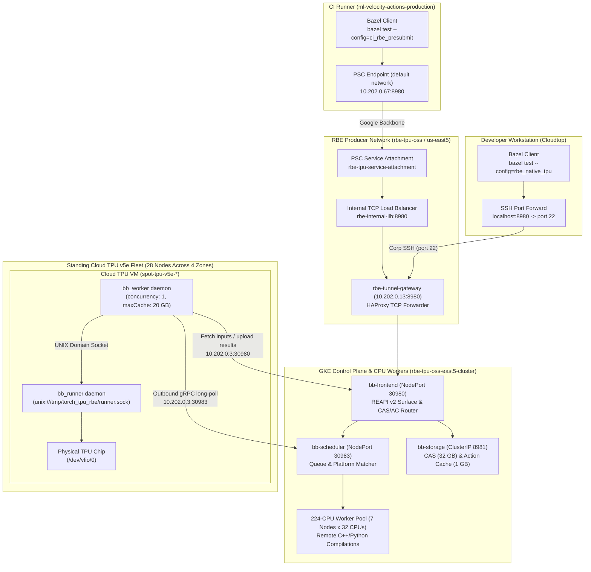

# Native Remote Build Execution on Cloud TPU Architecture

This document explains the architecture, networking, and deployment of native
Remote Build Execution (RBE) for `google-pytorch/torch_tpu` on physical Cloud
TPU hardware.

--------------------------------------------------------------------------------

## 1. Problem & Context

Hardware tests for `torch_tpu` require physical Cloud TPU chips (`/dev/vfio/0`).
Testing against real accelerators presents two scaling constraints:

1.  **A Single Shared Runner (`linux-x86-ct5lp-224-8tpu`):** Standard presubmit
    runs all tests sequentially on one dedicated machine. When multiple
    developers push changes, tests queue behind one another, delaying pull
    request verification.
2.  **Managed RBE Lacks TPU Workers:** Managed Remote Build Execution offerings
    (such as Google Cloud Foundry) provision standard CPU worker pools. They do
    not provide Cloud TPU instances as execution backends.

To run hardware tests in parallel across a pool of standing Cloud TPU v5e
virtual machines, `torch_tpu` runs a native Remote Build Execution cluster.

--------------------------------------------------------------------------------

## 2. REAPI v2 Architecture with Buildbarn

The cluster implements the open-source Remote Execution API (REAPI v2) using
Buildbarn. Bazel communicates directly with Buildbarn over gRPC.



--------------------------------------------------------------------------------

## 3. How It Works

### Step 1: Worker Registration (Inversion of Control)

Each TPU VM runs `bb_worker` as a systemd service. On startup, `bb_worker` dials
outbound to the Buildbarn scheduler at `10.202.0.3:30983` over internal VPC
networking.

-   The worker advertises platform keys:

    ```json
    "platform": {
      "properties": [
        { "name": "Accelerator", "value": "tpu-v5e" },
        { "name": "OSFamily", "value": "Linux" }
      ]
    }
    ```
-   Because workers initiate outbound connections to the scheduler, TPU VMs
    require zero listening ports, zero public IPs, and no incoming firewall
    rules.

### Step 2: Bazel Test Invocation

When a developer or CI runs:

```bash
bazel test --config=rbe_native_tpu //tests/pallas:pallas_test
```

Bazel evaluates `.bazelrc`:

-   `--spawn_strategy=local`: C++ compilations, code generation, and test
    binaries build locally on the client (or pull from local cache).
-   `--strategy=TestRunner=remote`: Only the test execution step dispatches
    remotely over REAPI v2.
-   `--remote_default_exec_properties=Accelerator=tpu-v5e`: Tells the scheduler
    to dispatch this action only to workers with a TPU v5e attached.
-   `--noremote_upload_local_results`: Prevents Bazel from uploading thousands
    of intermediate compiler objects to the CAS over the WAN.

### Step 3: Action Execution on Hardware

1.  The scheduler matches the test action to an idle TPU worker and hands off
    the action digest.
2.  `bb_worker` pulls input runfiles (such as `libtpu.so`, python virtual
    environments, and test scripts) from `bb-storage` into
    `/tmp/torch_tpu_rbe/build/`.
3.  `bb_worker` delegates execution to `bb_runner` via a local UNIX socket.
4.  `bb_runner` runs the test command directly on the host OS as root or runner
    user. The process opens `/dev/vfio/0` directly on the physical chip.
5.  `bb_worker` uploads test outputs (such as `test.xml`, `test.log`) to CAS and
    reports exit code `0` to the scheduler.

### Step 4: Remote Action Caching

Buildbarn stores the test result digest in its Action Cache (AC). If the inputs
and test target do not change, subsequent invocations hit the cache:

-   Fresh execution: ~18 seconds (staging dependencies + running tests on chip).
-   Cached execution: **0.348 seconds** (`(cached) PASSED`).

--------------------------------------------------------------------------------

## 4. Network Layout & Multi-Zone Topology

### Tunnel Gateway (`rbe-tunnel-gateway`)

The `rbe-tunnel-gateway` instance (`10.202.0.13`) is a dedicated Debian 12 GCE
virtual machine in zone `us-east5-a`. HAProxy listens on port `8980` and
forwards incoming TCP connections to the GKE NodePort `30980`
(`10.202.0.3:30980`) serving the Buildbarn frontend (`bb-frontend`). It runs in
TCP mode with a one hour idle timeout on each side, so a Bazel gRPC stream stays
up for the length of a build. `option tcplog` only writes its line when a
session closes, so an in-flight build produces no access log entries at all.

A `socat` unit listens on `8443` and forwards to the same backend. It exists
only so the load balancer health check has a port it can reach: the hierarchical
firewall policy permits the health check ranges on 80, 443, 8080, 8443, 9230 and
10402, and a probe to 8980 hits the deny-all rule instead.

### CI Runner Connectivity (Private Service Connect)

GitHub Actions runners in `ml-velocity-actions-production` reach the Buildbarn
frontend through Private Service Connect (PSC).

1.  A consumer forwarding rule in `ml-velocity-actions-production` publishes the
    reserved internal address `10.202.0.67:8980` on the runner's VPC (`default`,
    subnet `10.202.0.0/20` in `us-east5`). No DNS zone is registered, so
    `.bazelrc` dials the address directly.
2.  Traffic routes across Google's private datacenter backbone into the producer
    service attachment (`rbe-tpu-service-attachment`) in `us-east5`. PSC
    rewrites the source to the attachment's NAT subnet (`10.0.100.0/24`), which
    is what the producer firewall rules actually see.
3.  The service attachment hands off to an internal TCP load balancer
    (`rbe-internal-ilb:8980`), which forwards packets to `rbe-tunnel-gateway`.
4.  HAProxy on the gateway forwards the connection to the Buildbarn frontend
    (`bb-frontend`) on GKE NodePort `30980`.

Both sides number their subnets out of `10.202.0.0/20`, so the producer ILB
(`10.202.0.15`), the gateway (`10.202.0.13`) and the consumer endpoint
(`10.202.0.67`) all look like neighbours. They are not. They sit in separate
VPCs in separate projects and only the PSC attachment joins them.

Because packets stay on Google's private backbone, PSC traffic never touches the
public internet and bypasses edge ingress firewall restrictions.

### Developer Connectivity (Cloudtop / Corporate Workstations)

Developers connect to the Buildbarn frontend through `rbe-tunnel-gateway` on
port `8980` using a background SSH port-forwarding tunnel:

```bash
gcloud compute ssh rbe-tunnel-gateway \
  --zone=us-east5-a \
  --project=rbe-tpu-oss \
  -- -N -L 8980:127.0.0.1:8980 &
```

This route connects over Google corporate network CIDRs, which are explicitly
permitted by the project's hierarchical firewall policy (`163641247602` rules 30
and 31) on port 22. Once the local forward is listening, Bazel points to
`grpc://127.0.0.1:8980` as configured in `.bazelrc`.

### GCE Virtual Machine Connectivity (In-VPC)

Virtual machines running inside the `rbe-tpu-oss` VPC network bypass tunnels
entirely. They communicate directly with the Buildbarn frontend over internal IP
`10.202.0.13:8980`:

```bash
bazel test --config=rbe_native_tpu \
  --remote_executor=grpc://10.202.0.13:8980 \
  --remote_cache=grpc://10.202.0.13:8980 \
  //tests/pallas:pallas_test
```

### Security & Ingress Policy (Hierarchical Firewall)

Project `rbe-tpu-oss` enforces an organization-level hierarchical firewall
policy (`163641247602`):

-   **Rules 30 & 31**: Permit ingress exclusively from Google corporate network
    CIDRs on ports 22, 443, and 3389.
-   **Rule 28**: Permits ingress from designated cluster egress IPs on port 22.
-   **Rule 32**: Denies all other external ingress traffic (`0.0.0.0/0`).

Hierarchical firewall rules evaluate before project-level VPC rules. This drops
traffic from unwhitelisted external ranges, including Cloud IAP proxy CIDR
`35.235.240.0/20` and public GitHub runner IPs, at the edge.

Private Service Connect bypasses these edge ingress rules entirely because
consumer traffic enters the VPC through a dedicated service attachment on
Google's private backbone. For developer workstations, traffic connects over
authorized corporate CIDRs via SSH forwarding.

### Fleet Distribution & Latency

The GKE control plane lives in `us-east5`. The 28 standing Cloud TPU v5e nodes
sit across four regions in the GCP VPC network (`default`):

| Region / Zone    | TPU Nodes         | Round-Trip Latency to Scheduler |
| :--------------- | :---------------- | :------------------------------ |
| `us-east5-a`     | GKE Control Plane | Local (<1 ms)                   |
:                  : (`10.202.0.3`)    :                                 :
| `us-south1-a`    | 8 nodes           | ~32 ms                          |
| `us-west4-a`     | 4 nodes           | ~55 ms                          |
| `us-west1-c`     | 8 nodes           | ~68 ms                          |
| `europe-west4-b` | 8 nodes           | ~95 ms                          |

### Runfile Caching

`libtpu.so` is ~700 MB, and the Python virtual environment runfiles total ~2.6
GB. To avoid downloading 2.6 GB over cross-region links on every test:

-   Each TPU VM configures a 20 GB local worker cache
    (`/tmp/torch_tpu_rbe/cache`).
-   Files downloaded from the CAS remain on local disk across actions.
-   Successive tests on the same VM hard-link cached inputs instantly, keeping
    network traffic minimal.

--------------------------------------------------------------------------------

## 5. Repository Configuration & Bazel Usage

### `.bazelrc`

```ini
# Native Remote Build Execution on Cloud TPU v5e hardware via Buildbarn (REAPI v2)
common:rbe_native_tpu --remote_executor=grpc://127.0.0.1:8980
common:rbe_native_tpu --remote_cache=grpc://127.0.0.1:8980
common:rbe_native_tpu --remote_timeout=600s
common:rbe_native_tpu --noremote_upload_local_results
common:rbe_native_tpu --spawn_strategy=local
common:rbe_native_tpu --strategy=TestRunner=remote
common:rbe_native_tpu --remote_default_exec_properties=Accelerator=tpu-v5e
common:rbe_native_tpu --remote_default_exec_properties=OSFamily=Linux

# CI config matching .github/workflows/presubmit.yml
common:ci_rbe_presubmit --config=rbe_native_tpu
common:ci_rbe_presubmit --remote_executor=grpc://10.202.0.67:8980
common:ci_rbe_presubmit --remote_cache=grpc://10.202.0.67:8980
common:ci_rbe_presubmit --build_tests_only
common:ci_rbe_presubmit --color=yes
common:ci_rbe_presubmit --curses=no
common:ci_rbe_presubmit --build_tag_filters=-nobuild,requires-tpu-v5lite,requires-tpu-v5lite:8
common:ci_rbe_presubmit --test_tag_filters=presubmit-v5,-fails-on-tpu-v5,-nopresubmit,-notest,-nobuild,-requires-tpu-v5p,-requires-tpu-v6e,-requires-tpu-v7x
test:ci_rbe_presubmit --test_output=errors
```

### Running Tests Locally via Bazel

With the tunnel running on `localhost:8980`, execute tests directly with Bazel:

```bash
# Run an individual test target on a remote Cloud TPU:
bazel test --config=rbe_native_tpu //tests/pallas:pallas_test

# Run an entire test suite matching CI filters. Use rbe_native_tpu, not
# ci_rbe_presubmit: the CI config points at the PSC endpoint, which is only
# routable from inside the CI VPC.
bazel test --config=rbe_native_tpu \
  --test_tag_filters=presubmit-v5,-fails-on-tpu-v5,-nopresubmit,-notest,-nobuild \
  //tests:ops_test_tpu-v5lite
```

To run multiple tests in parallel across the standing TPU fleet, increase test
jobs:

```bash
bazel test --config=rbe_native_tpu --jobs=28 //tests/...
```

### GitHub Actions Presubmit (`.github/workflows/presubmit.yml`)

Pull requests trigger the native RBE presubmit job when labeled with
`ci:replace-tpu-v5` or `ci:relay-tpu-v5` (or when dispatched manually).

The `Presubmit on RBE` job runs `bazel test --config=ci_rbe_presubmit` directly
against `10.202.0.67:8980` over Private Service Connect using `bazel-diff`.
Because PSC provides a direct internal IP path across VPCs, the runner needs no
background tunnels, gcloud commands, or custom proxy daemons. Test results post
directly back to the pull request checks.

There is one job, not a matrix per accelerator. The runner is a plain CPU
machine and every test action is dispatched to a TPU worker by Buildbarn, so
hardware coverage is a property of the worker pool rather than of the workflow.
The pool is v5e only today, so `ci_rbe_presubmit` filters out
`requires-tpu-v5p`, `requires-tpu-v6e` and `requires-tpu-v7x`. Adding a
generation means editing those two filter lines and growing the pool; the
workflow does not change.

--------------------------------------------------------------------------------

## 6. Worker Daemon Management (systemd)

Each TPU node runs two systemd services:

1.  **`bb_runner.service`**: Listens on UNIX domain socket
    `/tmp/torch_tpu_rbe/runner.sock`. Executes actions delivered by `bb_worker`.
2.  **`bb_worker.service`**: Maintains the outbound gRPC session to
    `10.202.0.3:30983`, fetches action inputs, passes execution requests to
    `bb_runner`, and uploads results.

```bash
# Check worker status on any TPU node:
sudo systemctl status bb_worker.service
sudo systemctl status bb_runner.service

# View live worker logs:
journalctl -u bb_worker.service -f
```
