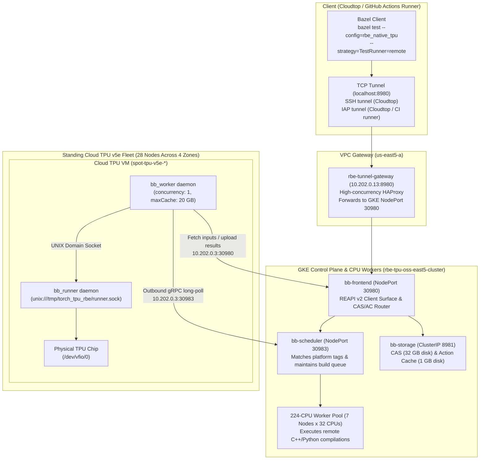

# Native Remote Build Execution on Cloud TPU Architecture

This document explains the architecture, networking, and deployment of native
Remote Build Execution (RBE) for `google-pytorch/torch_tpu` on physical Cloud
TPU hardware.

--------------------------------------------------------------------------------

## 1. Problem & Context

Hardware tests for `torch_tpu` require physical Cloud TPU chips (`/dev/vfio/0`).
Testing against real accelerators presents two scaling constraints:

1.  **A Single Shared Runner (`linux-x86-ct5lp-224-8tpu`):** Standard presubmit
    runs all tests sequentially on one dedicated machine. When multiple
    developers push changes, tests queue behind one another, delaying pull
    request verification.
2.  **Managed RBE Lacks TPU Workers:** Managed Remote Build Execution offerings
    (such as Google Cloud Foundry) provision standard CPU worker pools. They do
    not provide Cloud TPU instances as execution backends.

To run hardware tests in parallel across a pool of standing Cloud TPU v5e
virtual machines, `torch_tpu` runs a native Remote Build Execution cluster.

--------------------------------------------------------------------------------

## 2. REAPI v2 Architecture with Buildbarn

The cluster implements the open-source Remote Execution API (REAPI v2) using
Buildbarn. Bazel communicates directly with Buildbarn over gRPC.



--------------------------------------------------------------------------------

## 3. How It Works

### Step 1: Worker Registration (Inversion of Control)

Each TPU VM runs `bb_worker` as a systemd service. On startup, `bb_worker` dials
outbound to the Buildbarn scheduler at `10.202.0.3:30983` over internal VPC
networking.

-   The worker advertises platform keys:

    ```json
    "platform": {
      "properties": [
        { "name": "Accelerator", "value": "tpu-v5e" },
        { "name": "OSFamily", "value": "Linux" }
      ]
    }
    ```
-   Because workers initiate outbound connections to the scheduler, TPU VMs
    require zero listening ports, zero public IPs, and no incoming firewall
    rules.

### Step 2: Bazel Test Invocation

When a developer or CI runs:

```bash
bazel test --config=rbe_native_tpu //tests/pallas:pallas_test
```

Bazel evaluates `.bazelrc`:

-   `--spawn_strategy=local`: C++ compilations, code generation, and test
    binaries build locally on the client (or pull from local cache).
-   `--strategy=TestRunner=remote`: Only the test execution step dispatches
    remotely over REAPI v2.
-   `--remote_default_exec_properties=Accelerator=tpu-v5e`: Tells the scheduler
    to dispatch this action only to workers with a TPU v5e attached.
-   `--noremote_upload_local_results`: Prevents Bazel from uploading thousands
    of intermediate compiler objects to the CAS over the WAN.

### Step 3: Action Execution on Hardware

1.  The scheduler matches the test action to an idle TPU worker and hands off
    the action digest.
2.  `bb_worker` pulls input runfiles (such as `libtpu.so`, python virtual
    environments, and test scripts) from `bb-storage` into
    `/tmp/torch_tpu_rbe/build/`.
3.  `bb_worker` delegates execution to `bb_runner` via a local UNIX socket.
4.  `bb_runner` runs the test command directly on the host OS as root or runner
    user. The process opens `/dev/vfio/0` directly on the physical chip.
5.  `bb_worker` uploads test outputs (such as `test.xml`, `test.log`) to CAS and
    reports exit code `0` to the scheduler.

### Step 4: Remote Action Caching

Buildbarn stores the test result digest in its Action Cache (AC). If the inputs
and test target do not change, subsequent invocations hit the cache:

-   Fresh execution: ~18 seconds (staging dependencies + running tests on chip).
-   Cached execution: **0.348 seconds** (`(cached) PASSED`).

--------------------------------------------------------------------------------

## 4. Network Layout & Multi-Zone Topology

### Tunnel Gateway (`rbe-tunnel-gateway`)

The `rbe-tunnel-gateway` instance (`10.202.0.13`) is a dedicated Debian 12 GCE
virtual machine in zone `us-east5-a`. It runs high-concurrency HAProxy on port
`8980` and forwards incoming TCP connections to the GKE NodePort `30980`
(`10.202.0.3:30980`) serving the Buildbarn frontend (`bb-frontend`).

HAProxy handles connection pooling and high concurrency across parallel Bazel
connections, preventing connection dropouts and port exhaustion.

### Developer Connectivity (Cloudtop / Local Workstation)

Developers connect to the Buildbarn frontend through `rbe-tunnel-gateway` on
port `8980` using either an SSH tunnel or a Cloud IAP TCP tunnel.

#### Option A: SSH Tunnel

Open a background SSH tunnel to forward local port `8980`:

```bash
gcloud compute ssh rbe-tunnel-gateway \
  --zone=us-east5-a \
  --project=rbe-tpu-oss \
  -- -N -L 8980:localhost:8980
```

#### Option B: Cloud IAP TCP Tunnel

Open an IAP TCP forwarding tunnel:

```bash
gcloud compute start-iap-tunnel \
  rbe-tunnel-gateway 8980 \
  --local-host-port=localhost:8980 \
  --zone=us-east5-a \
  --project=rbe-tpu-oss
```

Once established, Bazel points to `grpc://127.0.0.1:8980` as configured in
`.bazelrc`.

### GitHub Actions CI Runner Connectivity

CI runners in GitHub Actions access the private GKE cluster via Cloud IAP.
Before executing Bazel tests, the CI workflow
(`.github/workflows/test_rbe_opt_in.yml`) opens a background IAP tunnel to
`rbe-tunnel-gateway`:

```bash
gcloud compute start-iap-tunnel \
  rbe-tunnel-gateway 8980 \
  --local-host-port=localhost:8980 \
  --zone=us-east5-a \
  --project=rbe-tpu-oss \
  --iap-tunnel-disable-connection-check
```

The workflow tests the TCP port until reachable on `127.0.0.1:8980`, runs Bazel,
and terminates the tunnel process on job exit.

### Fleet Distribution & Latency

The GKE control plane lives in `us-east5`. The 28 standing Cloud TPU v5e nodes
sit across four regions in the GCP VPC network (`default`):

| Region / Zone    | TPU Nodes         | Round-Trip Latency to Scheduler |
| :--------------- | :---------------- | :------------------------------ |
| `us-east5-a`     | GKE Control Plane | Local (<1 ms)                   |
:                  : (`10.202.0.3`)    :                                 :
| `us-south1-a`    | 8 nodes           | ~32 ms                          |
| `us-west4-a`     | 4 nodes           | ~55 ms                          |
| `us-west1-c`     | 8 nodes           | ~68 ms                          |
| `europe-west4-b` | 8 nodes           | ~95 ms                          |

### Runfile Caching

`libtpu.so` is ~700 MB, and the Python virtual environment runfiles total ~2.6
GB. To avoid downloading 2.6 GB over cross-region links on every test:

-   Each TPU VM configures a 20 GB local worker cache
    (`/tmp/torch_tpu_rbe/cache`).
-   Files downloaded from the CAS remain on local disk across actions.
-   Successive tests on the same VM hard-link cached inputs instantly, keeping
    network traffic minimal.

--------------------------------------------------------------------------------

## 5. Repository Configuration & Bazel Usage

### `.bazelrc`

```ini
# Native Remote Build Execution on Cloud TPU v5e hardware via Buildbarn (REAPI v2)
common:rbe_native_tpu --remote_executor=grpc://127.0.0.1:8980
common:rbe_native_tpu --remote_cache=grpc://127.0.0.1:8980
common:rbe_native_tpu --remote_timeout=600s
common:rbe_native_tpu --noremote_upload_local_results
common:rbe_native_tpu --spawn_strategy=local
common:rbe_native_tpu --strategy=TestRunner=remote
common:rbe_native_tpu --remote_default_exec_properties=Accelerator=tpu-v5e
common:rbe_native_tpu --remote_default_exec_properties=OSFamily=Linux

# CI config matching .github/workflows/test_rbe_opt_in.yml
common:ci_tpu_v5_full_rbe --config=rbe_native_tpu
common:ci_tpu_v5_full_rbe --build_tests_only
common:ci_tpu_v5_full_rbe --color=yes
common:ci_tpu_v5_full_rbe --curses=no
common:ci_tpu_v5_full_rbe --build_tag_filters=-nobuild,requires-tpu-v5lite,requires-tpu-v5lite:8,requires-tpu-v5p,requires-tpu-v5p:4,requires-tpu-v6e,requires-tpu-v7x,requires-tpu-v7x:4
test:ci_tpu_v5_full_rbe --test_output=errors
```

### Running Tests Locally via Bazel

With the tunnel running on `localhost:8980`, execute tests directly with Bazel:

```bash
# Run an individual test target on a remote Cloud TPU:
bazel test --config=rbe_native_tpu //tests/pallas:pallas_test

# Run an entire test suite matching CI filters:
bazel test --config=ci_tpu_v5_full_rbe //tests:ops_test_tpu-v5lite
```

To run multiple tests in parallel across the standing TPU fleet, increase test
jobs:

```bash
bazel test --config=rbe_native_tpu --jobs=28 //tests/...
```

### GitHub Actions Presubmit (`.github/workflows/test_rbe_opt_in.yml`)

Pull requests trigger native RBE presubmit jobs when labeled with
`ci:replace-tpu-v5` or `ci:relay-tpu-v5` (or when dispatched manually). The
workflow starts the IAP tunnel to `rbe-tunnel-gateway:8980`, runs
`bazel test --config=ci_tpu_v5_full_rbe`, and posts test results back to the pull
request checks.

--------------------------------------------------------------------------------

## 6. Worker Daemon Management (systemd)

Each TPU node runs two systemd services:

1.  **`bb_runner.service`**: Listens on UNIX domain socket
    `/tmp/torch_tpu_rbe/runner.sock`. Executes actions delivered by `bb_worker`.
2.  **`bb_worker.service`**: Maintains the outbound gRPC session to
    `10.202.0.3:30983`, fetches action inputs, passes execution requests to
    `bb_runner`, and uploads results.

```bash
# Check worker status on any TPU node:
sudo systemctl status bb_worker.service
sudo systemctl status bb_runner.service

# View live worker logs:
journalctl -u bb_worker.service -f
```
