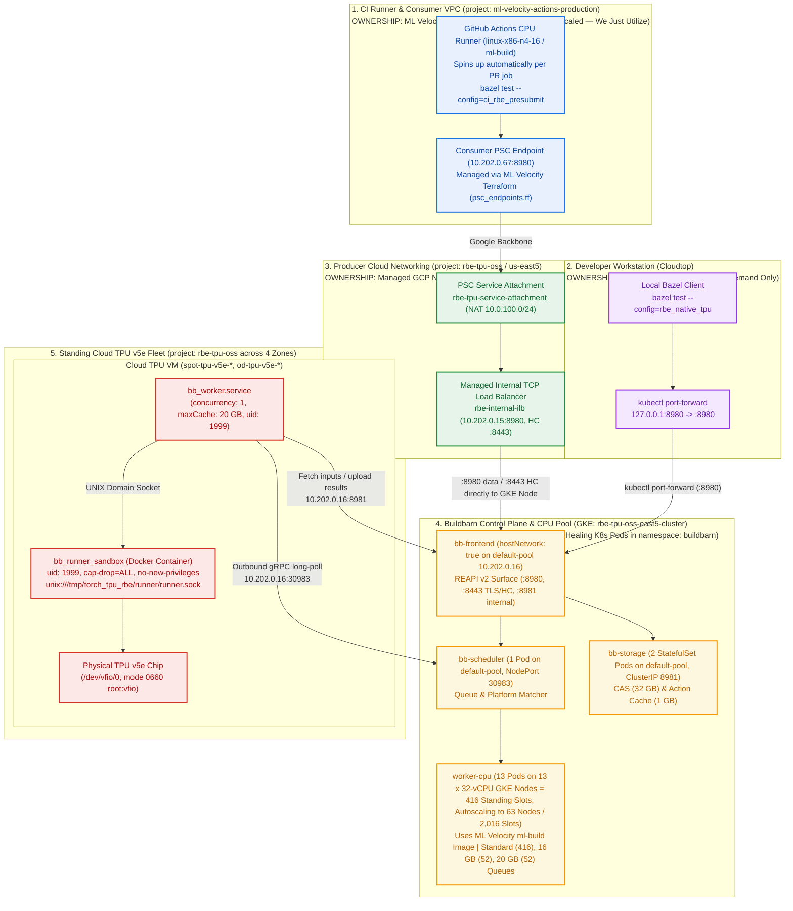

# Native Remote Build Execution on Cloud TPU Architecture

This document explains the architecture, networking, and deployment of native
Remote Build Execution (RBE) for `google-pytorch/torch_tpu` on physical Cloud
TPU hardware.

--------------------------------------------------------------------------------

## 1. Problem & Context

Hardware tests for `torch_tpu` require physical Cloud TPU chips (`/dev/vfio/0`).
Testing against real accelerators presents two scaling constraints:

1.  **A Single Shared Runner (`linux-x86-ct5lp-224-8tpu`):** Standard presubmit
    runs all tests sequentially on one dedicated machine. When multiple
    developers push changes, tests queue behind one another, delaying pull
    request verification.
2.  **Managed RBE Lacks TPU Workers:** Managed Remote Build Execution offerings
    (such as Google Cloud RBE) provision standard CPU worker pools. They do not
    provide Cloud TPU instances as execution backends.

To run hardware tests in parallel across a pool of standing Cloud TPU v5e
virtual machines, `torch_tpu` runs a native Remote Build Execution cluster.

--------------------------------------------------------------------------------

## 2. REAPI v2 Architecture with Buildbarn

The cluster implements the open-source Remote Execution API (REAPI v2) using
Buildbarn. Bazel communicates directly with Buildbarn over gRPC.



### Component Ownership & Operational Lifecycle

Every component in the diagram above is **already deployed and live**. No
additional services need to be stood up to merge or merge-gate this workflow.

<!-- mdformat off(GitHub renders this file; keep the single-line table) -->
Diagram Layer                           | Component                                                                                                                                         | Owner                                                    | Current State & Lifecycle                                                                                                                                                                                                    | What We Maintain
:-------------------------------------- | :------------------------------------------------------------------------------------------------------------------------------------------------ | :------------------------------------------------------- | :--------------------------------------------------------------------------------------------------------------------------------------------------------------------------------------------------------------------------- | :---------------
**1. Blue** *(External / Utilized)*     | **GitHub Actions Runner (`linux-x86-n4-16`) & `ml-build` Image**                                                                                  | **ML Velocity Infra** (`ml-velocity-actions-production`) | **Automatic / Ephemeral**: Spins up on demand per PR workflow run and tears down automatically when the job finishes.                                                                                                        | **Nothing.** We reference `runs-on: linux-x86-n4-16` and the `ml-build` image in `rbe_presubmit.yml`.
**1. Blue** *(External / Utilized)*     | **Consumer PSC Endpoint (`10.202.0.67:8980`)**                                                                                                    | **ML Velocity Infra** (`psc_endpoints.tf`)               | **Already Provisioned**: Static forwarding rule (`rbe-tpu-buildbarn-psc-endpoint`) managed by ML Velocity's `terraform_ci` pipeline (`status: ACCEPTED`).                                                                    | **Nothing.** We point `--remote_executor=grpcs://10.202.0.67:8980` with mTLS client certificates at it in `.bazelrc`.
**2. Purple** *(Ephemeral Client)*      | **Developer SSH Tunnel (`127.0.0.1:8980`)**                                                                                                       | **Individual Developer** (Cloudtop)                      | **On-Demand**: Started by an engineer only when running remote TPU tests locally from a workstation. Never used by CI.                                                                                                       | **Nothing.**
**3. Green** *(Managed GCP Networking)* | **PSC Service Attachment (`rbe-tpu-service-attachment`) & Internal LB (`rbe-internal-ilb`)**                                                      | **TorchTPU Team** (`rbe-tpu-oss`), **Managed by GCP**    | **Already Provisioned**: Cloud-native VPC networking objects in `us-east5`. Directs traffic straight to GKE node group without intermediary gateway VMs.                                                                     | **Managed networking.** Only modified if adding consumer GCP projects to `consumerAcceptLists`.
**4. Amber** *(TorchTPU K8s Infra)*     | **Buildbarn Control Plane (`bb-frontend`, `bb-scheduler`, `bb-storage`) & 416-Slot Standing CPU Pool (`worker-cpu`, Autoscaling to 2,016 Slots)** | **TorchTPU Team** (`rbe-tpu-oss-east5-cluster`)          | **Already Deployed**: Control plane pods run on `default-pool` (`10.202.0.16`) with `safe-to-evict: "false"` and `hostNetwork: true`. CPU workers scale from 13 standing nodes (`416` vCPUs) up to 63 nodes (`2,016` vCPUs). | **Owned by us.** Configured via ConfigMaps `buildbarn-config` and `bb-worker-cpu-config`, `HorizontalPodAutoscaler/worker-cpu-hpa` (`13 -> 63` pods), and GKE Cluster Autoscaler (`cpu-worker-pool` `13..45` + `cpu-worker-pool-burst` `0..18`).
**5. Red** *(TorchTPU TPU Fleet)*       | **32 Standing Cloud TPU v5e Workers (`spot-tpu-v5e-*`, `od-tpu-v5e-*`)**                                                                          | **TorchTPU Team** (`rbe-tpu-oss`)                        | **Already Deployed**: 32 single-chip on-demand TPU VMs across 4 zones running `bb_worker.service` and containerized `bb_runner_sandbox` under `uid=1999` with `/dev/vfio/*` mode `0660 root:vfio`.                           | **Owned by us.** Despite the `spot-` prefix, all 32 are on-demand VMs, so GCE doesn't preempt them. On-demand v5e quota is 8 per zone, and all 4 zones are full.
<!-- mdformat on -->

--------------------------------------------------------------------------------

## 3. How It Works

### Step 1: Worker Registration & Multi-Queue Memory Pools

Workers connect to the scheduler via outbound gRPC sessions, eliminating the
need for inbound firewall rules or public IP addresses. The cluster maintains
two distinct pools:

#### TPU Worker Pool (Hardware Execution)

Each standing TPU VM runs `bb_worker` as a systemd service. On startup,
`bb_worker` dials outbound to the scheduler and frontend storage on the GKE
control plane node (`10.202.0.16`). Because workers initiate outbound
connections directly, TPU VMs require zero listening ports, zero public IPs, and
no incoming firewall rules.

> [!NOTE] Operational note: All TPU workers connect outbound to the GKE control
> plane node (`10.202.0.16`). A GKE node auto-upgrade or auto-repair on
> `default-pool` would change this node IP and disconnect the fleet. The node
> pool is configured with a maintenance exclusion window, and productionizing
> will front these services with an internal load balancer or stable internal
> DNS.

Each worker advertises:

```json
"platform": {
  "properties": [
    { "name": "Accelerator", "value": "tpu-v5e" },
    { "name": "OSFamily", "value": "Linux" }
  ]
}
```

#### CPU Worker Pool & Multi-Queue Memory (`worker-cpu.jsonnet`)

The CPU worker pool runs inside GKE with a baseline of **13 standing 32-vCPU
nodes (416 concurrent slots)** and autoscales up to **63 32-vCPU nodes (2,016
concurrent slots)** under multi-PR build load:

-   **Primary Node Pool (`cpu-worker-pool`):** `n2-standard-32` (`32` vCPUs,
    `128 GB` RAM) in `us-east5-a` with GKE Cluster Autoscaler enabled for **13
    minimum nodes (`416` vCPUs)** up to **45 maximum nodes (`1,440` vCPUs)**
    within the regional `N2_CPUS` quota (`1,500` vCPUs).
-   **Burst Overflow Node Pool (`cpu-worker-pool-burst`):** `n2d-standard-32`
    (`32` vCPUs, `128 GB` RAM) in `us-east5-a` with GKE Cluster Autoscaler
    enabled for **0 minimum nodes** up to **18 maximum nodes (`576` vCPUs)**
    using the independent regional `N2D_CPUS` quota (`1,500` vCPUs), bringing
    total cluster CPU worker capacity to **63 nodes (`2,016` vCPUs)**.
-   **Control-Plane Isolation (`default-pool`):** `bb-frontend` (1 pod),
    `bb-scheduler` (1 pod), and `bb-storage` (2 StatefulSet pods) use
    `nodeAffinity` preferring `default-pool` (`n2-standard-8`, `10.202.0.16`)
    and excluding `cpu-worker-pool-burst`, paired with
    `cluster-autoscaler.kubernetes.io/safe-to-evict: "false"`, so control-plane
    and CAS/AC pods never compete with 32-core C++ compile spikes and are never
    evicted during node scale-down.
-   **1-to-1 Pod-to-Node Autoscaling (`worker-cpu-hpa`):** Each `worker-cpu` pod
    requests `28,000m` CPU (`26,000m` for `runner` + `2,000m` for `worker`) and
    `64 GiB` RAM, combined with `podAntiAffinity` on `kubernetes.io/hostname`
    and `nodeAffinity` preferring `cpu-worker-pool` (weight `100`) before
    overflowing to `cpu-worker-pool-burst`.
    `HorizontalPodAutoscaler/worker-cpu-hpa` scales `Deployment/worker-cpu`
    between `minReplicas: 13` (`416` slots) and `maxReplicas: 63` (`2,016`
    slots) at 60% CPU utilization with a 900-second scale-down stabilization
    window, `terminationGracePeriodSeconds: 300`, and a `preStop` drain hook on
    `runner` that waits for `/worker/build` to empty before closing the runner
    socket.

CPU worker pods run the official `ml-build` runner image:

```
us-central1-docker.pkg.dev/ml-velocity-actions-production/ci-runners/ml-build
```

This replaces legacy generic runner images and ensures compilers, system
libraries, Python runtimes, and LLVM/sysroot dependencies match the CI
environment.

In `worker-cpu.jsonnet`, each 32-vCPU worker pod partitions into three memory
queues to handle different action types without memory exhaustion:

-   **Standard Runner (`OSFamily=Linux`):** 32 slots per pod (**416 standing
    slots**, scaling up to **2,016 slots**). Handles standard C++ compilation,
    Python packaging, and genrules.
-   **High-Memory 16 GB Runner (`OSFamily=Linux`, `mem=16g`):** 4 slots per pod
    (**52 standing slots**, scaling up to **252 slots**). Matches
    `cpp_link.mem=16g` set in `//build_files:build_defs.bzl` (for example, in
    `//csrc/distributed:process_group_tpu_test`). C++ link actions with heavy
    symbol tables or AddressSanitizer (ASan) instrumentation land on this queue.
-   **High-Memory 20 GB Runner (`OSFamily=Linux`, `mem=20g`):** 4 slots per pod
    (**52 standing slots**, scaling up to **252 slots**). Handles large
    monolithic link steps and heavy binary generation.

### Step 2: Bazel Invocation & Dual-Pool Platform Routing

When a developer or CI runs:

```bash
bazel test --config=rbe_native_tpu //tests/pallas:pallas_test
```

Bazel resolves the execution platform configured in
`//bazel/platforms:BUILD.bazel`:

```python
platform(
    name = "buildbarn_native_tpu_platform",
    constraint_values = [
        "@platforms//cpu:x86_64",
        "@platforms//os:linux",
    ],
    exec_properties = {
        "OSFamily": "Linux",
        "test.Accelerator": "tpu-v5e",
        "test.OSFamily": "Linux",
    },
    visibility = ["//visibility:public"],
)
```

This configuration splits execution across both pools using Bazel execution
groups:

-   **Default Execution Group (`OSFamily=Linux`):** Applies to all compilation,
    linking, and genrules. The scheduler routes these actions to the 416-slot
    standing CPU worker pool (autoscaling up to 2,016 slots).
-   **Test Execution Group (`test.Accelerator=tpu-v5e`,
    `test.OSFamily=Linux`):** Applies exclusively to Bazel's built-in `test`
    execution group. The scheduler routes test runner actions to the 32 standing
    Cloud TPU v5e workers.

Two design requirements govern this platform definition:

-   **No `parents` inheritance:** Buildbarn keys worker queues on exact platform
    property matching. Inheriting properties like `cache-silo-key` from
    `@ml_build_config_platform//:platform` causes queue mismatches where actions
    find no matching workers. The platform defines its constraints directly.
-   **Explicit `test.OSFamily`:** Repeated for explicitness so the test action
    clearly specifies `Accelerator=tpu-v5e` and `OSFamily=Linux`.

Additional flags applied from `.bazelrc`:

-   `--jobs=200`: Configures each build/compile invocation to drive up to 200
    concurrent remote actions against the 416-slot standing CPU pool
    (autoscaling to 2,016 slots under multi-PR load). Without this flag, Bazel
    sizes jobs to the local client core count.
-   `--noremote_upload_local_results`: Serves as an accident guard keeping
    locally executed developer builds from writing to the shared Action Cache.
    Remote actions are cached directly by Buildbarn.
-   `--remote_timeout=3600s`: Extends per-RPC deadlines so concurrent actions
    uploading inputs do not time out under load.

### Step 3: Action Execution on Hardware

1.  The scheduler matches the action to an idle worker matching the requested
    platform properties (CPU pool for compilation, TPU pool for tests).
2.  For test actions, `bb_worker` on the TPU node pulls input runfiles (such as
    `libtpu.so`, Python virtual environments, and test binaries) from
    `bb-storage` into `/tmp/torch_tpu_rbe/build/`.
3.  `bb_worker` delegates execution to `bb_runner` via a local UNIX domain
    socket (`/tmp/torch_tpu_rbe/runner/runner.sock`).
4.  `bb_runner` executes inside the `bb_runner_sandbox` Docker container under
    unprivileged user `bb-runner` (`uid 1999:1999`) with `--cap-drop=ALL` and
    `--security-opt=no-new-privileges`. The process accesses `/dev/vfio/0` (mode
    `0660 root:vfio`) on the physical chip. Input files in the hard-linked local
    cache are populated with read-only permissions (`0555`/`0444`) to prevent
    accidental modification.
5.  `bb_runner` enables process-table cleaning (`cleanProcessTable: true`) and
    command cleanup hooks (`runCommandCleaner`) to terminate any leaked child
    processes and release the `/dev/vfio/0` device handle between actions.
6.  `bb_worker` uploads test outputs (such as `test.xml`, `test.log`) to CAS and
    reports exit code `0` to the scheduler.

### Step 4: Remote Action Caching

Buildbarn stores action digests in its Action Cache (AC) backed by `bb-storage`.
When target sources and input hashes do not change, subsequent builds skip
execution entirely:

-   Fresh execution: Runs across the worker pools (~55m cold presubmit).
-   Cached execution: Instant cache hit in **0.348 seconds** (`(cached)
    PASSED`).

--------------------------------------------------------------------------------

## 4. Network Layout & Multi-Zone Topology

### Direct GKE Ingress (No Intermediary VM Gateways)

The data path routes directly to GKE without intermediate proxy VMs:

1.  `bb-frontend` runs with `hostNetwork: true` (`dnsPolicy:
    ClusterFirstWithHostNet`) pinned to GKE node `10.202.0.16` (`default-pool`).
2.  The managed Internal TCP Load Balancer (`rbe-internal-ilb:8980`) points
    directly to the GKE instance group
    (`gke-rbe-tpu-oss-east5-cl-default-pool-af71f464-grp`).
3.  Load balancer health checks probe port `8443` directly on `bb-frontend`,
    which complies with Google hierarchical firewall health check ranges.
4.  This direct-to-node topology eliminates `rbe-tunnel-gateway` from the data
    path entirely, removing single-VM bottlenecks and operational overhead.

### CI Runner Connectivity (Private Service Connect)

GitHub Actions runners in `ml-velocity-actions-production` reach the Buildbarn
frontend through Private Service Connect (PSC).

1.  A consumer forwarding rule in `ml-velocity-actions-production` publishes the
    reserved internal address `10.202.0.67:8980` on the runner's VPC (`default`,
    subnet `10.202.0.0/20` in `us-east5`). No DNS zone is registered
    (`no_automate_dns_zone = true`), so `.bazelrc` dials the address directly.
2.  Traffic routes across Google's private datacenter backbone into the producer
    service attachment (`rbe-tpu-service-attachment`) in `us-east5`. PSC
    rewrites the source to the attachment's NAT subnet (`10.0.100.0/24`), which
    is what the producer firewall rules actually see.
3.  The service attachment hands off to the internal TCP load balancer
    (`rbe-internal-ilb:8980`), which forwards packets directly to the GKE node
    running `bb-frontend` (`10.202.0.16:8980`).

Both sides number their subnets out of `10.202.0.0/20`, so the producer ILB
(`10.202.0.15`), the GKE node (`10.202.0.16`), and the consumer endpoint
(`10.202.0.67`) all look like neighbours. They are not. They sit in separate
VPCs in separate projects and only the PSC attachment joins them.

Because packets stay on Google's private backbone, PSC traffic never touches the
public internet and bypasses edge ingress firewall restrictions.

### Developer Connectivity (Cloudtop / Corporate Workstations)

Developers connect to the Buildbarn frontend through `kubectl port-forward` to
port `8980`:

```bash
kubectl port-forward -n buildbarn svc/frontend 8980:8980 &
```

Once listening locally, Bazel points to `grpcs://127.0.0.1:8980` as configured
in `.bazelrc` under `--config=rbe_native_tpu`.

### GCE Virtual Machine Connectivity (In-VPC)

Virtual machines running inside the `rbe-tpu-oss` VPC network communicate
directly with the Buildbarn frontend over the internal load balancer
`10.202.0.15:8980` via TLS:

```bash
bazel test --config=rbe_native_tpu \
  --remote_executor=grpcs://10.202.0.15:8980 \
  //tests/pallas:pallas_test
```

### Security & Trust Model

#### Trust Model

Everyone who can push a branch to `google-pytorch/torch_tpu` or who holds the
RBE client certificate is trusted. The controls here stop outsiders and
accidental damage, not malicious insiders. The following rely on that assumption
and must be revisited if it changes:

-   **Shared mTLS credentials:** One shared mTLS client certificate and key are
    used for CI and developers (no per-user identity or revocation). Same-repo
    PR code runs with the client key available on disk.
-   **Action Cache write access:** Any client cert holder can write directly to
    the Action Cache. The `--noremote_upload_local_results` flag in `.bazelrc`
    is a client-side guard against accidental local cache pollution, not a
    security boundary.
-   **In-VPC execution:** Build and test actions run PR-controlled code on CPU
    pods and TPU VMs inside the `rbe-tpu-oss` VPC.
-   **Shared worker reuse:** TPU workers and scratch space (`/tmp`, `/dev/shm`,
    worker cache, TPU device state) are reused across actions and PRs.

#### Ingress Policy & Sandboxing

Project `rbe-tpu-oss` enforces defense in depth against external access and
accidental corruption:

1.  **Container Sandboxing (`bb_runner_sandbox`):** All TPU action execution
    runs inside unprivileged Docker containers (`--user 1999:1999`,
    `--cap-drop=ALL`, `--security-opt=no-new-privileges`). Test code cannot
    modify host files, load kernel modules, or escalate privileges. Host
    `/dev/vfio/*` devices are locked down to mode `0660 root:vfio`.
2.  **Network Isolation:** Private Service Connect uses connection policy
    `ACCEPT_MANUAL` restricted exclusively to consumer project
    `ml-velocity-actions-production`. The endpoint is an internal RFC 1918
    address (`10.202.0.67`) and is not internet-routable.
3.  **Edge Firewall:** Hierarchical firewall rules drop all unauthorized
    external traffic (`0.0.0.0/0`) at the perimeter while permitting Google
    corporate CIDRs.
4.  **Frontend Authentication & TLS:** `bb-frontend` enforces TLS (`grpcs://`)
    and mutual TLS (mTLS) client certificate verification
    (`tlsClientCertificate`), requiring a valid client certificate signed by the
    trusted root CA on incoming REAPI requests. In CI, credentials populate
    dynamically into `/tmp/rbe-certs/` from GitHub Actions Secrets during runner
    initialization; local developers keep certificates in
    `~/.config/torch_tpu/certs/` or `/tmp/rbe-certs/`. No private keys are
    committed to source control. Unauthenticated connections without valid
    certificates fail immediately.

### Fleet Distribution & Latency

The GKE control plane lives in `us-east5`. The 32 standing Cloud TPU v5e nodes
sit across four regions in the `rbe-tpu-oss` VPC network:

| Region / Zone    | TPU Nodes              | Round-Trip Latency to Scheduler |
| :--------------- | :--------------------- | :------------------------------ |
| `us-east5-a`     | GKE Control Plane Node | Local (<1 ms)                   |
:                  : (`10.202.0.16`)        :                                 :
| `us-south1-a`    | 8 nodes                | ~32 ms                          |
| `us-west4-a`     | 8 nodes                | ~55 ms                          |
| `us-west1-c`     | 8 nodes                | ~68 ms                          |
| `europe-west4-b` | 8 nodes                | ~95 ms                          |

### Runfile Caching

`libtpu.so` is ~700 MB, and the Python virtual environment runfiles total ~2.6
GB. To avoid downloading 2.6 GB over cross-region links on every test:

-   Each TPU VM configures a 20 GB local worker cache
    (`/tmp/torch_tpu_rbe/cache`).
-   Files downloaded from the CAS remain on local disk across actions.
-   Successive tests on the same VM hard-link cached inputs instantly, keeping
    network traffic minimal.
-   `bb_worker` keeps an in-memory cache of Directory objects (`directoryCache`,
    256 MiB). Without it, the worker fetches every directory in the input tree
    from us-east5 one at a time on every action, which took 80-150 seconds per
    test from the far zones. With it, a warm fetch takes under a second.

--------------------------------------------------------------------------------

## 5. Repository Configuration & Bazel Usage

### 5.1 `.bazelrc`

The RBE configuration flags and CI profiles are maintained in `.bazelrc`:

-   `--config=rbe_native_tpu`: Configures the remote executor endpoint, mTLS
    client credentials, platform routing via
    `//bazel/platforms:buildbarn_native_tpu_platform`, `--jobs=200`, and gRPC
    keepalives.
-   `--config=ci_rbe_presubmit`: Extends `ci_base` and `rbe_native_tpu`,
    targeting the Private Service Connect endpoint (`10.202.0.67:8980`), setting
    `--test_timeout=3600`, and applying tag filters for single-chip TPU v5e
    tests.

Refer directly to `.bazelrc` in the repository for the canonical flag
definitions.

#### Key Flags and Filter Explanations

-   **gRPC Keepalives (`--grpc_keepalive_time=15s`,
    `--grpc_keepalive_timeout=15s`,
    `--experimental_remote_execution_keepalive=true`):** Maintains active pings
    on gRPC connections every 15 seconds. This prevents intermediary stateful
    firewalls and NAT gateways from dropping idle TCP sockets during extended
    compilation steps or test executions.
-   **Distributed 8-Chip Exclusion (`-requires-tpu-v5lite:8`):** The standing
    TPU pool consists of single-chip v5e (v5lite-1) nodes. Tests requiring an
    8-chip slice topology cannot execute on single-chip worker nodes. When
    `run-rbe` is enabled, the RBE workflow runs in parallel with the standard
    serial runner (`linux-x86-ct5lp-224-8tpu`), which continues to execute
    8-chip distributed tests.
-   **External Network Exclusion (`-requires-net:external`):** Excludes tests
    (such as `remote_tier3_compilation_cache_test`) that connect to external
    network services or Google Cloud Storage. Buildbarn RBE workers operate
    hermetically with no outbound internet access and no cloud storage write
    credentials. These tests continue to run on the standard runner.

### 5.2 Running Tests Locally via Bazel

With `kubectl port-forward` running on `localhost:8980`, execute tests directly
with Bazel:

```bash
# Run an individual test target on a remote Cloud TPU:
bazel test --config=rbe_native_tpu //tests/pallas:pallas_test

# Run an entire test suite matching CI filters. Use rbe_native_tpu, not
# ci_rbe_presubmit: the CI config points at the PSC endpoint, which is only
# routable from inside the CI VPC.
bazel test --config=rbe_native_tpu \
  --test_tag_filters=presubmit-v5,-fails-on-tpu-v5,-nopresubmit,-notest,-nobuild \
  //tests:ops_test_tpu-v5lite
```

> [!NOTE] Shared worker etiquette: `--config=rbe_native_tpu` sets `--jobs=200`
> by default. Because the 32 standing TPU worker nodes are shared between ad-hoc
> local runs and GitHub Actions CI, there is no scheduler priority or queuing
> fairness. Be considerate when running large suites or using high
> `--runs_per_test` multipliers.

### 5.3 Presubmit CI Workflow Details (`.github/workflows/rbe_presubmit.yml`)

The native RBE workflow runs as a standalone workflow in
`.github/workflows/rbe_presubmit.yml`.

#### Runner Environment

The job executes on a standard CPU runner:

-   **Runner:** `linux-x86-n4-16`
-   **Container:**
    `us-docker.pkg.dev/ml-oss-artifacts-published/ml-public-container/ml-build@sha256:30a9cf...`
-   **Timeout:** `timeout-minutes: 120`
-   **IPC:** `--ipc=host`

The runner executes `bazel test --config=ci_rbe_presubmit` directly against
`10.202.0.67:8980` over Private Service Connect using `bazel-diff`. Because PSC
provides a direct internal route across VPCs, the runner requires no background
tunnels or proxy daemons.

#### Opt-In Execution and Concurrency

To ensure stability across the repository:

-   **Isolated Workflow & Concurrency:** The workflow defines its own
    concurrency group (`${{ github.workflow }}-${{ github.head_ref ||
    github.run_id }}`). Adding PR labels never cancels running jobs in the main
    presubmit matrix (`presubmit.yml`).
-   **Additive Verification:** Labeling a PR with `run-rbe` triggers
    `rbe_presubmit` alongside standard presubmit. Standard presubmit continues
    to run unmodified on `ct5lp`, ensuring that distributed 8-chip tests and
    external-network tests remain fully covered.
-   **Fork Protection:** The workflow checks
    `github.event.pull_request.head.repo.full_name == github.repository` to
    ensure fork PRs do not trigger RBE runs or access secrets.

--------------------------------------------------------------------------------

## 6. Worker Daemon Management (systemd)

Each TPU node runs two systemd services:

1.  **`bb_runner.service`**: Executes actions inside the unprivileged
    `bb_runner_sandbox` Docker container (`uid 1999:1999`) via UNIX domain
    socket `/tmp/torch_tpu_rbe/runner/runner.sock`.
2.  **`bb_worker.service`**: Maintains the outbound gRPC session to
    `10.202.0.16:30983` (scheduler), fetches action inputs via
    `10.202.0.16:8981` (frontend storage), passes execution requests to
    `bb_runner`, and uploads results.

```bash
# Check worker status on any TPU node:
sudo systemctl status bb_worker.service
sudo systemctl status bb_runner.service

# View live worker logs:
journalctl -u bb_worker.service -f
```

--------------------------------------------------------------------------------

## 7. Performance & Verified Benchmarks

Real end-to-end presubmit runs verify build acceleration across both pools:

| Metric         | Cold Presubmit  | Warm Presubmit Run  | Notes               |
:                : Run             : (Cached)            :                     :
| :------------- | :-------------- | :------------------ | :------------------ |
| **Total        | ~55 minutes     | **14 minutes 22     | **74% overall       |
: Duration**     :                 : seconds**           : speedup**           :
| **Action Cache | 0 actions       | **>20,000 actions** | Instant cache hits  |
: Hits**         :                 :                     : from Action Cache   :
| **CPU Actions  | Full C++        | 8 actions           | CPU phase completes |
: Executed**     : compilation     :                     : in ~4 minutes       :
| **TPU Test     | 78 test targets | 78 test targets     | Dispatched in       |
: Targets**      :                 :                     : parallel across     :
:                :                 :                     : standing nodes      :
| **Test Pass    | 78 / 78 passed  | 78 / 78 passed      | 100% pass rate      |
: Rate**         : (100%)          : (100%)              : across all suites   :

### Cold vs. Warm Execution Breakdown

1.  **Cold Run (~55m):**

    -   Compiles all C++, LLVM/OpenXLA dependencies, and PyTorch extensions
        across the 416 standing CPU worker slots (autoscaling up to 2,016
        slots).
    -   Dispatches test targets in parallel across the standing Cloud TPU v5e
        nodes.

2.  **Warm Run (14m 22s):**

    -   More than 20,000 compilation and toolchain actions hit the Action Cache
        instantly.
    -   Bazel executes only non-cached actions on the CPU pool, finishing the
        CPU phase in about 4 minutes.
    -   All 78 test targets run across the standing TPU workers in parallel,
        finishing in ~10 minutes.
    -   78 of 78 tests pass cleanly. The filtered 8-chip distributed tests and
        external-network tests are excluded by `-requires-tpu-v5lite:8` and
        `-requires-net:external`.
    -   Compilation caches (`/dev/shm/torch_tpu_cache`) operate hermetically
        under unprivileged container sandboxing (`uid=1999`).
